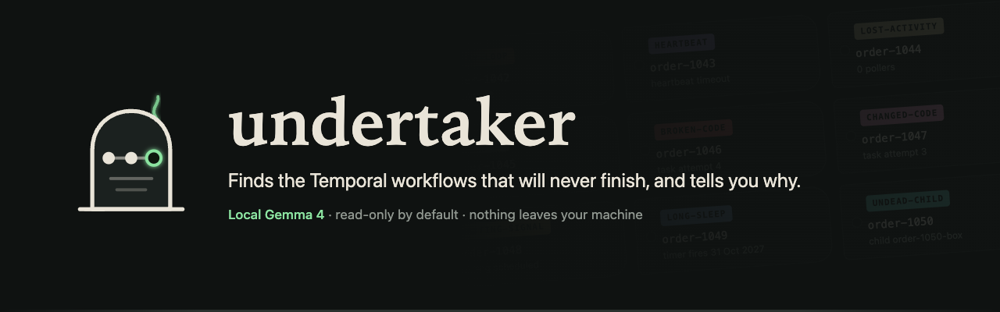
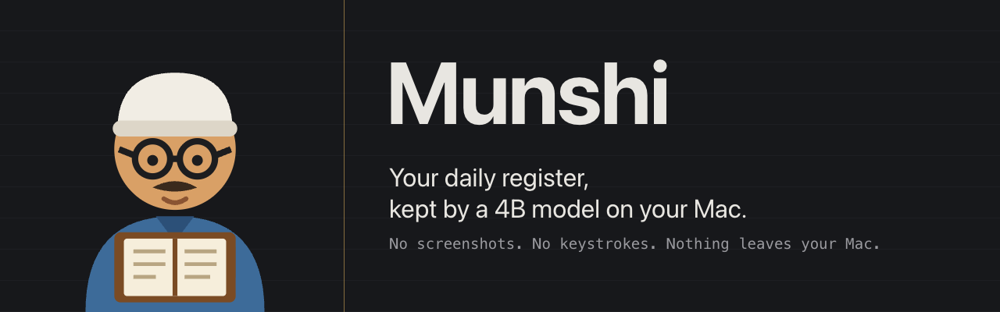
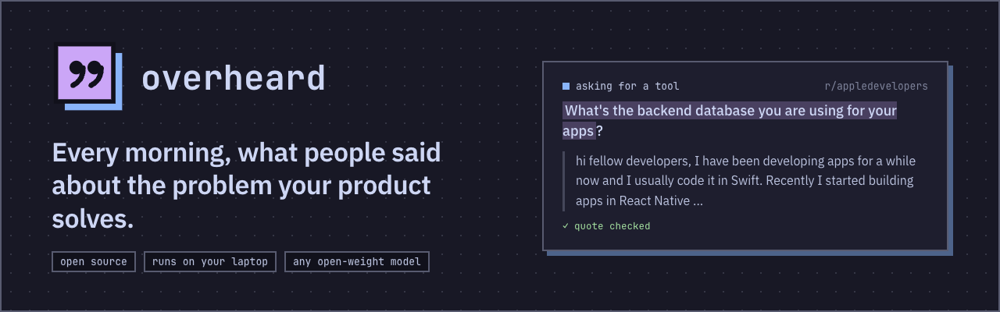
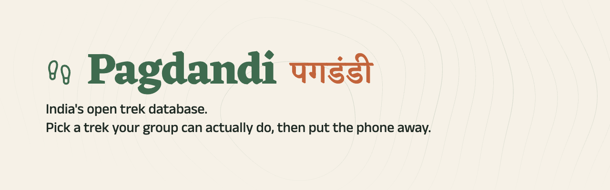
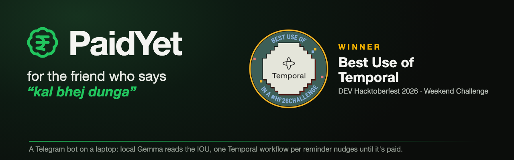
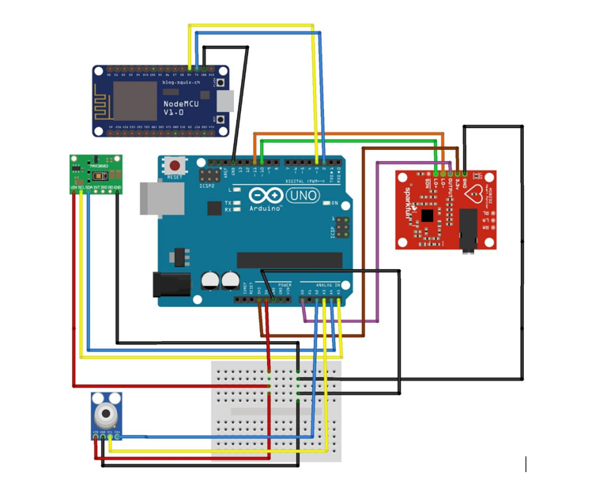

# Projects

<!-- Newest first, like the blog and the résumé. -->

-   :material-skull-outline:{ .lg .middle } __Undertaker__

    ---

    { .card-banner loading=lazy }

    Finds the Temporal workflows that will never finish, and tells you why. Local Gemma 4, read-only by default. Built for the DEV Hacktoberfest 2026 Week 4 challenge: Ghost in the Machine.

    [:octicons-arrow-right-24: More Details](./undertaker/index.md)

-   :material-notebook-outline:{ .lg .middle } __Munshi__

    ---

    { .card-banner loading=lazy }

    A desktop buddy for your Mac that keeps your daily register with a local open-weight model (Gemma 4 via Ollama). No screenshots, no keystrokes, nothing leaves your Mac. Built for the DEV Hacktoberfest 2026 Week 3 challenge: Slow and Steady.

    [:octicons-arrow-right-24: More Details](./munshi/index.md)

-   :material-newspaper-variant-outline:{ .lg .middle } __Overheard__

    ---

    { .card-banner loading=lazy }

    Every morning, what people said on Reddit and Hacker News about the problem your product solves. Self-hosted: open-weight models, Temporal, Postgres. Built for the DEV Hacktoberfest 2026 Week 2 challenge: Side Hustle.

    [:octicons-arrow-right-24: More Details](./overheard/index.md)

-   :material-hiking:{ .lg .middle } __Pagdandi__

    ---

    { .card-banner loading=lazy }

    India's open trek database: 20 sourced treks, a Gemma trek guide on your laptop (Mastra + Ollama), hybrid search on Tiger Data, ElevenLabs audio intros and a daily email with SerpApi news. Built for the DEV Hacktoberfest 2026 Week 1 challenge: Touch Grass.

    [:octicons-arrow-right-24: More Details](./pagdandi/index.md)

-   :material-cash-clock:{ .lg .middle } __PaidYet__

    ---

    { .card-banner loading=lazy }

    Telegram bot that reads bills and IOUs with local Gemma (Ollama) and keeps reminding until you pay. Durable reminders on Temporal, agent traces in Sentry. Won Best Use of Temporal in the DEV Hacktoberfest 2026 Weekend Challenge.

    [:octicons-arrow-right-24: More Details](./paidyet/index.md)

-   :material-heart-pulse:{ .lg .middle } __DocAid__

    ---

    { .card-figure loading=lazy }

    Capstone project combining an IoT wearable (Arduino + health sensors) with a real-time Django/Channels dashboard for hospital patient monitoring. Submited at Thapar University, 2023.

    [:octicons-arrow-right-24: More Details](./doc-aid/index.md)

<!-- Card template for the next project — image classes: .card-cover
     (screenshot, crops to fill 16:9), .card-figure (diagram, shown
     whole on a white plate) or .card-banner (a 1280×400 README banner,
     shown whole at 16:5). Keep exactly one link per card: the CSS
     stretches it over the whole card and hides its text.

-   :material-robot:{ .lg .middle } __Project Name__

    ---

    { .card-cover loading=lazy }

    One or two sentence description.

    [:octicons-arrow-right-24: More Details](./<slug>/index.md)
-->

<!-- -   :fontawesome-brands-markdown:{ .lg .middle } __It's just Markdown__

    ---

    Focus on your content and generate a responsive and searchable static site

    [:octicons-arrow-right-24: Reference](#)

-   :material-format-font:{ .lg .middle } __Made to measure__

    ---

    Change the colors, fonts, language, icons, logo and more with a few lines

    [:octicons-arrow-right-24: Customization](#)

-   :material-scale-balance:{ .lg .middle } __Open Source, MIT__

    ---

    Material for MkDocs is licensed under MIT and available on [GitHub]

    [:octicons-arrow-right-24: License](#) -->

