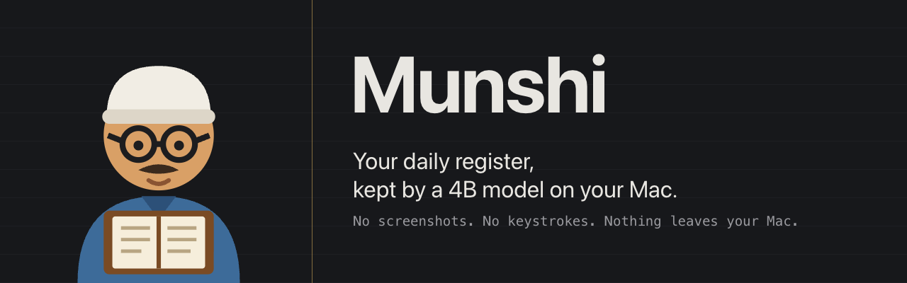
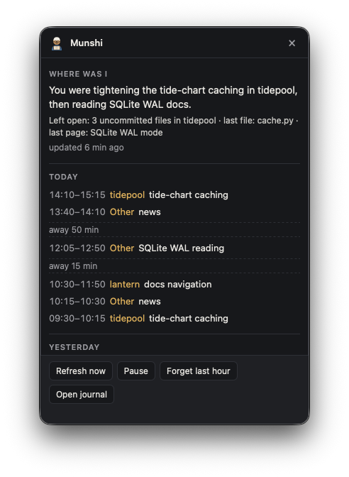
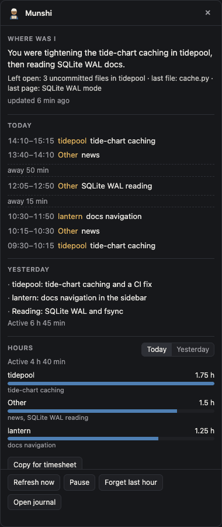
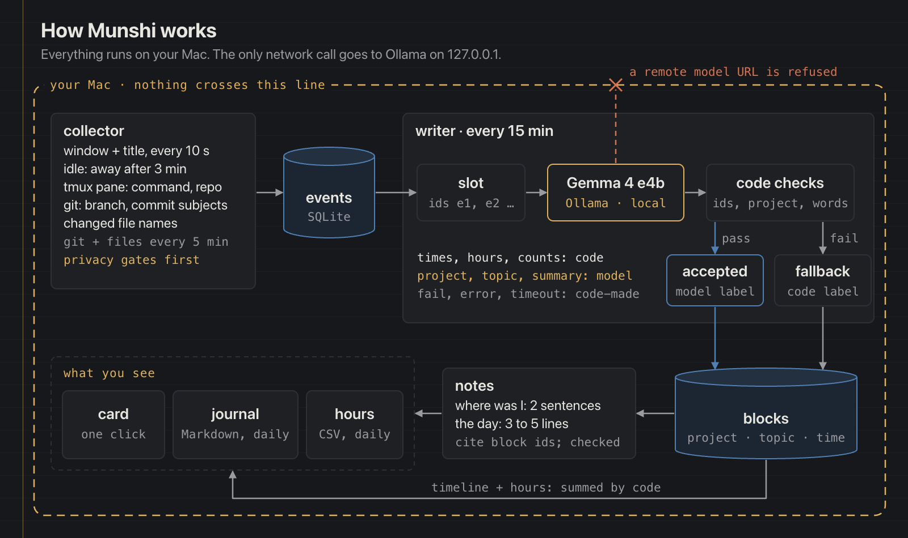

---
hide:
  - feedback
---

# :material-notebook-outline: Munshi

[:material-source-repository: Source Repo](https://github.com/prateek11rai/munshi){: .report-pill target="_blank" rel="noopener noreferrer" } [:fontawesome-brands-dev: Submission Post](https://dev.to/prateek11rai/my-hours-now-write-themselves-every-15-minutes-from-a-4b-model-that-never-leaves-my-mac-o95){: .report-pill target="_blank" rel="noopener noreferrer" }

> Your daily register, kept by a 4B model on your Mac. A desktop buddy that notes which app and window are in front and, for folders you choose, the git branch, and writes your hours every 15 minutes with Gemma 4 through Ollama. No screenshots, no keystrokes, nothing leaves your Mac.

{ loading=lazy }

## :material-lightbulb-outline: The Problem

A log of every window you open is the most private data on a computer. Rewind, the Mac app that remembered everything, stopped capturing on 2025-12-19 after Meta bought its maker. The record was the user's; the decision to stop was not.

So a record like this should live on your Mac, in code you can read, with a model you can swap. Munshi keeps everything in one folder that only you can read, talks only to Ollama on your own computer, and works with any model you pull. The model writes words; code checks them and computes every number.

## :material-monitor-dashboard: What It Does

A small munshi (a clerk with spectacles, a cap and a ledger) sits on your Mac's desktop and keeps your register for you. It notes which app and window are in front and, for folders you choose, the git branch, commit subjects and changed file names. Every 15 minutes a local open-weight model (Gemma 4 e4b through Ollama) turns that into plain lines, and code checks every one. Click the munshi and a card opens beside it: where was I, today's blocks, yesterday's lines and hours per project.

{ loading=lazy }

{ loading=lazy }

## :material-sitemap-outline: How It Works

{ loading=lazy }

- **Collector.** Every 10 seconds it reads the front app and the window title (through Accessibility); after 3 minutes without input you are away. Every 5 minutes, under the folders you list, it reads git branches, commit subjects and changed file names. Every privacy gate runs before anything is stored.
- **Writer and code checks.** Every 15 minutes each finished slot goes to the model with stable ids, your projects and the existing topics. The model answers JSON at temperature 0. Code checks every answer: the ids exist and are not already taken, the project is one you have, the topic is a subject of at most 4 words and never an app name.
- **Notes.** After each run a "where was I" note covers the last two hours. When a day ends, a day note of 3 to 5 lines, a Markdown journal page and an hours CSV are written. Notes cite block ids and face the same checks.
- **Numbers come only from code.** Times, hours, counts and "updated 6 min ago" are computed; digits are stripped from model text, so the model never writes a number you see.

## :material-shield-lock-outline: Privacy

- Everything stays on your Mac. The only network call goes to the model on your own computer; Munshi refuses a remote model address unless you allow it on purpose.
- It records the front app's name, the window title and, for folders you list, the git branch, commit subjects and names of changed files. No screenshots, no keystrokes, no clipboard history, no browser history, no file contents, no diffs.
- Password managers, Keychain Access, System Settings and the lock screen are never recorded, nor any app you add to the ignore list. Private and incognito windows are recorded as the app name only.
- Emails, links (only the site name is kept), tokens and long numbers are removed before anything is saved.
- **Pause** stops all recording; **Forget last hour** deletes it. Raw window events are deleted after 14 days.
- Window titles are treated as data, never as instructions. The model has no tools, and code checks every line it writes.

## :material-robot-outline: Models

Any Ollama model works. The checks are the same for every model, so a weaker model means more code-made lines, never wrong numbers. Measured with `gemma4:e4b` on an M-series Mac:

| | Demo days | Real use |
|---|---|---|
| Active time labelled by the model | 95 % | about 80 % |
| Seconds per slot, model loaded | about 3 | about 9 |

At rest the app uses about 30–45 MB of memory and close to 0 % CPU.

## :material-trophy-outline: Built For

The DEV Hacktoberfest Open-Source AI Challenge, Week 3: Slow and Steady, part of Hacktoberfest 2026 (MLH × DEV): something with open-weight AI that rewards laziness. The submission post: [My hours now write themselves every 15 minutes, from a 4B model that never leaves my Mac](https://dev.to/prateek11rai/my-hours-now-write-themselves-every-15-minutes-from-a-4b-model-that-never-leaves-my-mac-o95).

Two agent sessions built it: session A, the base on made-up demo data only, and session B, real recording and tuning on real numbers. A planner session wrote each brief and reviewed every diff; build agents, each in its own tmux window, wrote the code.

## :material-source-repository: The Repo

Full source, the build log and the design briefs are on GitHub:

[:octicons-mark-github-16: prateek11rai/munshi](https://github.com/prateek11rai/munshi)

---

:material-notebook-outline: Built for the **DEV Hacktoberfest 2026 Week 3 challenge: Slow and Steady**, October 2026.
