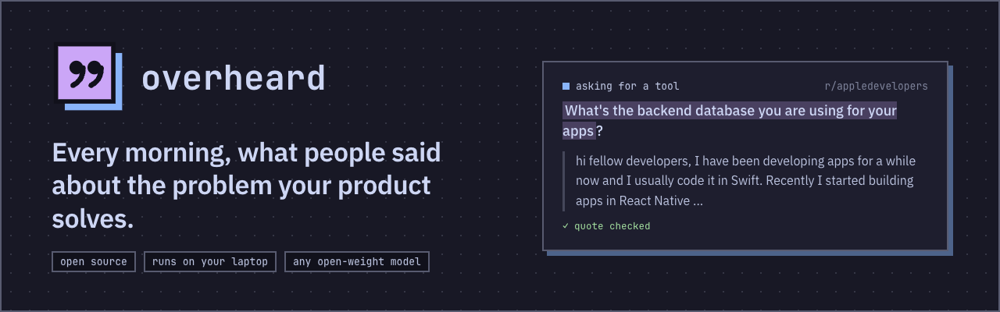
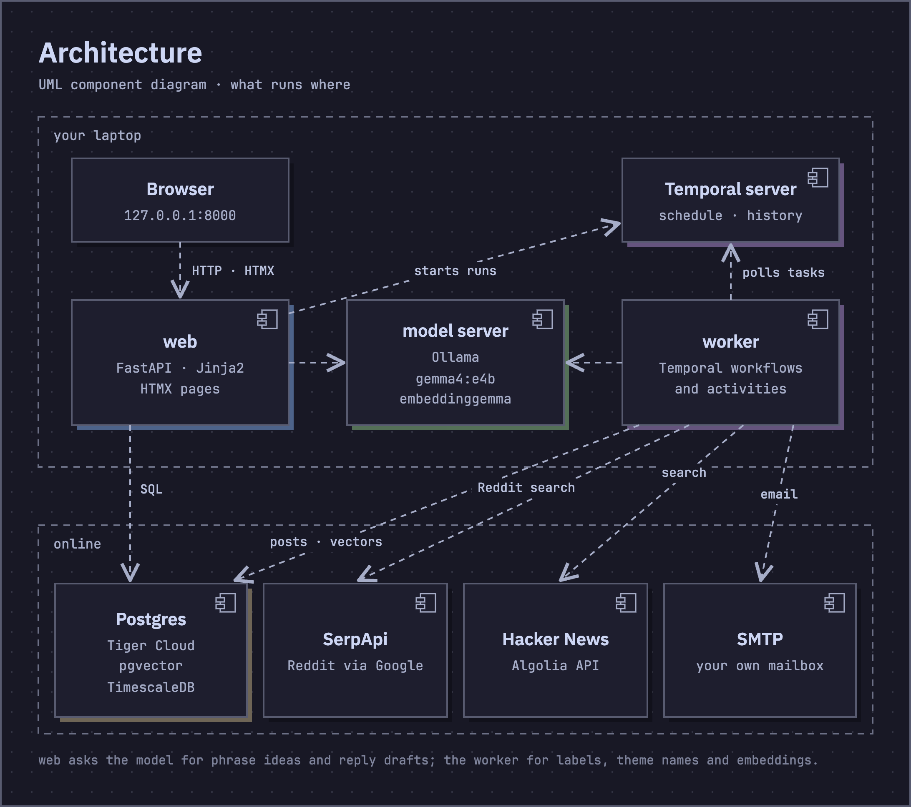
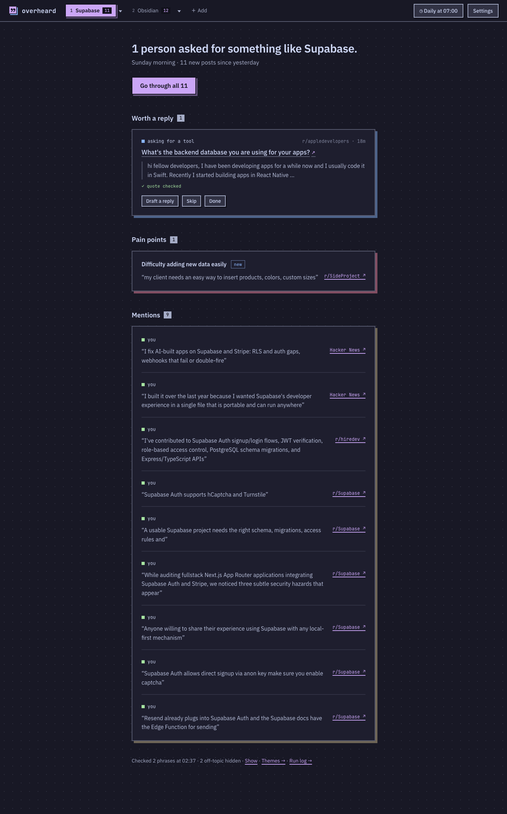
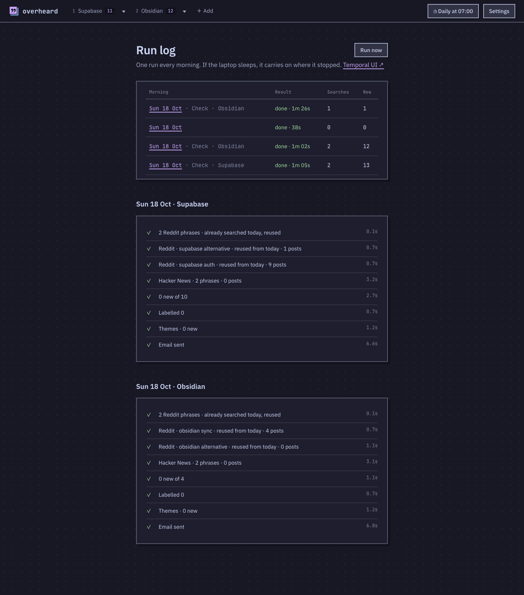

---
hide:
  - feedback
---

# :material-newspaper-variant-outline: Overheard

[:material-source-repository: Source Repo](https://github.com/prateek11rai/overheard){: .report-pill target="_blank" rel="noopener noreferrer" } [:fontawesome-brands-dev: Submission Post](https://dev.to/prateek11rai/gummysearch-deletes-everyones-data-on-december-1-i-rebuilt-its-morning-loop-on-a-4b-model-on-my-71i){: .report-pill target="_blank" rel="noopener noreferrer" } [:material-play-circle-outline: Demo Video](https://github.com/prateek11rai/overheard#demo){: .report-pill target="_blank" rel="noopener noreferrer" }

> Every morning, what people said on Reddit and Hacker News about the problem your product solves. Self-hosted: open-weight models, Temporal, Postgres. Built for the DEV Hacktoberfest 2026 Week 2 challenge: Side Hustle.

{ loading=lazy }

## :material-lightbulb-outline: The Problem

People pay for this today. GummySearch sold Reddit audience research (pain points, "is there a tool for…" requests) to roughly 400 paying customers at its peak. It closed to new users on 30 Nov 2025 and deletes all user data on 1 Dec 2026, because it couldn't get a commercial licence for Reddit's data. Paid successors are still selling, and the open-source options we found were a CLI and a small project. We found no maintained, self-hostable app that does the whole morning loop.

Overheard is that app: open source, on your laptop, with any open-weight model. Your list of products and competitors never leaves your machine, and labelling a few hundred posts costs nothing.

## :material-monitor-dashboard: What It Does

Overheard reads Reddit (through Google, via SerpApi) and Hacker News for the phrases that describe each of your products, labels what it finds with an open-weight model on your own laptop, and sends you one short email per product: who asked for a tool like yours, which pains keep coming up, and who mentioned you or a competitor. Every label comes with a sentence quoted from the post, and the app checks that the quote is really there.

## :material-sitemap-outline: How It Works

{ loading=lazy }

At the morning time (07:00 by default), one Temporal workflow runs each active product:

1. **Plan searches.** One Reddit search (one SerpApi credit) per phrase per morning; Hacker News is free. If your plan can't cover every phrase every day, phrases take turns.
2. **Search** Reddit through Google (title and snippet) and Hacker News (full text): the past day, or the past week on a new product's first check.
3. **Save** new posts only.
4. **Label** each post as *asking for a tool*, *pain point*, *mentions you*, *competitor* or *off-topic*. The model must return the exact sentence that justifies the label, and code checks that the quote is really in the post.
5. **Theme** pain points with embeddings in pgvector: a post joins the nearest theme or starts a new one, which the model names.
6. **Email** one digest per product from your own mailbox.

A morning missed because the laptop was asleep runs when it wakes (12-hour catch-up). A search that fails is retried, and a retry never spends a second search.

## :material-image-multiple-outline: Screens

From a live run on 18 Oct 2026, with two well-known products as the topics (Supabase and Obsidian), real Reddit and Hacker News posts, Tiger Cloud and `gemma4:e4b`.

{ loading=lazy }

{ loading=lazy }

## :material-robot-outline: Models

Overheard talks to Ollama, or to any OpenAI-compatible server (LM Studio, llama.cpp, vLLM). It finds what is installed, tells chat models from embedding models, and shows each as *in use*, *loaded*, *installed* or *unreachable* in Settings. On this laptop, on the checked set of 90 posts (30 written for the set and 60 Hacker News items fetched live):

| | gemma4:e4b |
|---|---|
| right label | 76/90 (synthetic 28/30, Hacker News 48/60) |
| quote checks out | 94% |
| asking-for-a-tool recall | 8/8 |
| seconds per post | 2.9 |

The labels are proposed, not yet checked by a person.

## :material-alert-circle-outline: Honest Limits

- Reddit content is Google's title and snippet only, not full threads or comments, and Google indexes with some delay.
- SerpApi's free plan is 250 searches a month (about 8 a day). Without a key, Overheard runs on Hacker News alone.
- Labels from a 4B model are good, not perfect; the eval shows how good on your laptop.
- Inspired by GummySearch; not affiliated with it.

## :material-trophy-outline: Built For

The DEV Hacktoberfest Open-Source AI Challenge, Week 2: Side Hustle, part of Hacktoberfest 2026 (MLH × DEV). The submission post: [GummySearch deletes everyone's data on December 1. I rebuilt its morning loop on a 4B model on my laptop](https://dev.to/prateek11rai/gummysearch-deletes-everyones-data-on-december-1-i-rebuilt-its-morning-loop-on-a-4b-model-on-my-71i). Categories entered: Gemma, Temporal, SerpApi, Tiger Data. The live run used Tiger Cloud (Postgres 18.6, TimescaleDB 2.30.2, pgvector 0.8.7).

## :material-source-repository: The Repo

Full source, the runbook and the demo video are on GitHub:

[:octicons-mark-github-16: prateek11rai/overheard](https://github.com/prateek11rai/overheard)

---

:material-newspaper-variant-outline: Built for the **DEV Hacktoberfest 2026 Week 2 challenge: Side Hustle**, October 2026.
