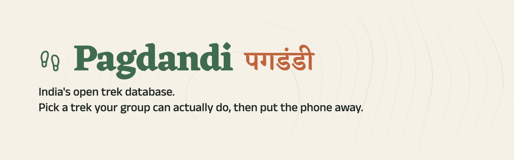
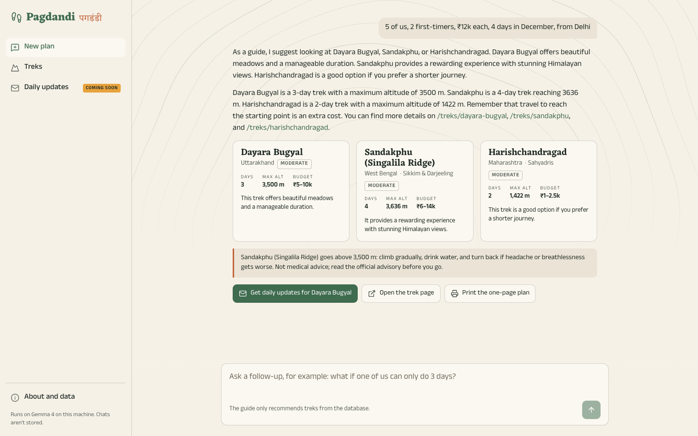
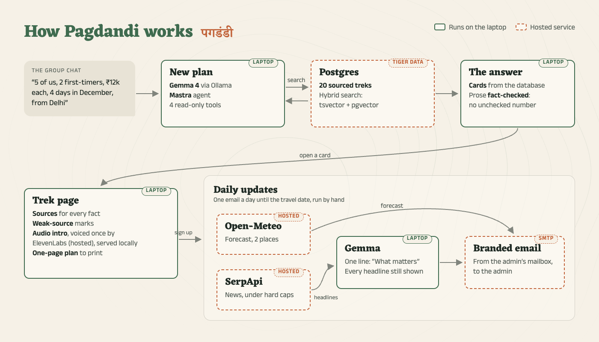
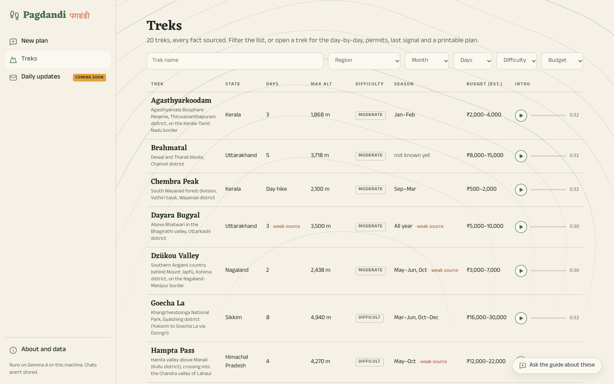

---
hide:
  - feedback
---

# :material-hiking: Pagdandi

[:material-source-repository: Source Repo](https://github.com/prateek11rai/pagdandi){: .report-pill target="_blank" rel="noopener noreferrer" } [:fontawesome-brands-dev: Submission Post](https://dev.to/prateek11rai/pagdandi-an-open-trek-database-that-gets-the-group-chat-onto-an-actual-trail-171d){: .report-pill target="_blank" rel="noopener noreferrer" } [:material-play-circle-outline: Demo Video](https://github.com/prateek11rai/pagdandi#readme){: .report-pill target="_blank" rel="noopener noreferrer" }

> India's open trek database: 20 sourced treks, a Gemma trek guide on your laptop (Mastra + Ollama), hybrid search on Tiger Data, ElevenLabs audio intros and a daily email with SerpApi news. Built for the DEV Hacktoberfest 2026 Week 1 challenge: Touch Grass.

{ loading=lazy }

## :material-lightbulb-outline: The Problem

Every city has this group chat. Five college friends in Delhi NCR (a composite of groups we all know) have been saying *"is baar pakka trek chalenge"* ("this time we're definitely going on a trek") for three years. Different budgets, two first-timers, and nobody wants to be the one who plans it.

Pagdandi is built for that moment: ten minutes to agree on a trek, then the phone goes in a pocket, with the intro downloaded and the one-page plan printed.

## :material-monitor-dashboard: What It Does

**Pagdandi** (पगडंडी, "footpath") is for that group. Tell it how many of you there are, who has trekked before, the budget, the days, the month and where you're starting from, and it recommends treks you can actually do, from 20 well-known Indian treks with sourced facts. Four ways in:

- **Ask the guide.** "5 of us, 2 first-timers, ₹12k each, 4 days in December, from Delhi." The guide answers in a few sentences, and the cards, nearest first, come from the database. Treks above 3,500 m come with an altitude note.
- **Browse the table.** All 20 treks in one table, with plain filters. Every fact names its source, a missing fact says "not known yet", and a fact whose only source is weak is marked.
- **Open a trek.** Each trek page has sources for every fact, an altitude warning above 3,500 m, a short audio intro to download for the drive, and a plan that prints on one page: the day-by-day, permits, last mobile signal and an altitude figure.
- **Get daily updates** (admin-only for now). One email a day until you leave: the forecast at the road head and the high point, this week's news, and one thing to do outside today.

{ loading=lazy }

## :material-sitemap-outline: How It Works

{ loading=lazy }

1. **A new plan.** The guide is Gemma 4 (`gemma4:e4b`) through Ollama on the laptop that serves the site: no server, and no per-chat bill. A Mastra agent with four read-only tools turns the group's question into searches.
2. **Search.** Postgres (Tiger Data or a local one) with hybrid search: full-text `tsvector` plus pgvector embeddings from EmbeddingGemma, fused with reciprocal rank fusion.
3. **The answer.** Cards come from the database, and plain code checks every number in the guide's sentences; anything that doesn't match becomes "(see the card)".
4. **The trek page.** Sources for every fact, weak-source marks, an audio intro voiced once by ElevenLabs and served locally, and the one-page plan to print.
5. **Daily updates.** Open-Meteo gives the forecast at two places, SerpApi the news under hard caps, Gemma writes one "What matters" line with every headline still shown, and the email goes out from the admin's mailbox over SMTP.

{ loading=lazy }

## :material-database-outline: Data

Each trek is a YAML file, written from open sources only: Wikipedia, Wikivoyage, OpenStreetMap, UNESCO and government pages, never trekking companies. Every fact that isn't `null` names the source that backs it, and the schema rejects anything else. If a fact can't be sourced it stays `null`, and the site says "not known yet". We never guess an altitude. Difficulty and budget are our own estimates, made with fixed rules and labelled as such. The data is CC BY-SA 4.0.

## :material-shield-lock-outline: Privacy and Safety

- Chats go to the model on the laptop serving the site, not to a model company. The page holds the conversation in memory only, and nothing is logged.
- The guide's prompt is fixed on the server, its four tools only read the database, and chats are capped.
- A red-team suite runs real Gemma against off-topic requests, prompt injection, requests for its prompt, treks and altitudes we don't have, a Hinglish group, and HTML in the message.
- Not medical advice, and not a substitute for a licensed local guide.

## :material-trophy-outline: Built For

The DEV Hacktoberfest Open-Source AI Challenge, Week 1: Touch Grass, part of Hacktoberfest 2026 (MLH × DEV). The submission post: [Pagdandi: an open trek database that gets the group chat onto an actual trail](https://dev.to/prateek11rai/pagdandi-an-open-trek-database-that-gets-the-group-chat-onto-an-actual-trail-171d).

| Category | How Pagdandi uses it |
|---|---|
| Gemma | Gemma 4 runs the guide and writes the "What matters" line over the daily news; EmbeddingGemma powers search. Both run through Ollama on the laptop. |
| Tiger Data | Postgres with pgvector: the treks, the hybrid search index, conditions, subscriptions and API budget counters. |
| SerpApi | Google News results for each followed trek (closures, landslides, snowfall, permits), behind per-day and per-month caps. |
| ElevenLabs | A short audio intro for every trek, generated once from its sourced script and committed as an MP3. |
| Mastra | The agent framework behind the guide: the agent, its read-only tools and the streaming chat. |

## :material-source-repository: The Repo

Full source, the trek data and the demo video are on GitHub:

[:octicons-mark-github-16: prateek11rai/pagdandi](https://github.com/prateek11rai/pagdandi)

---

:material-hiking: Built for the **DEV Hacktoberfest 2026 Week 1 challenge: Touch Grass**, October 2026. Code MIT, data CC BY-SA 4.0.
