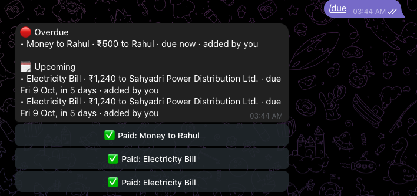
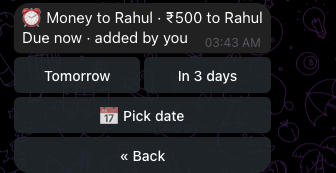
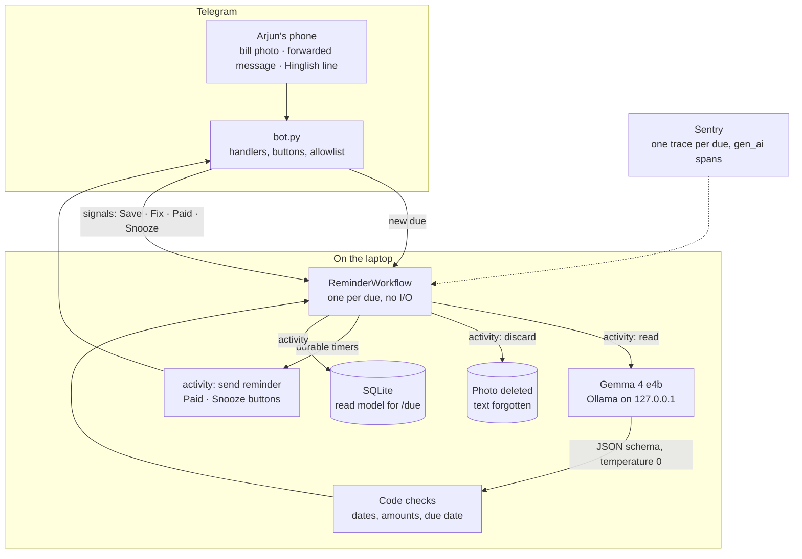
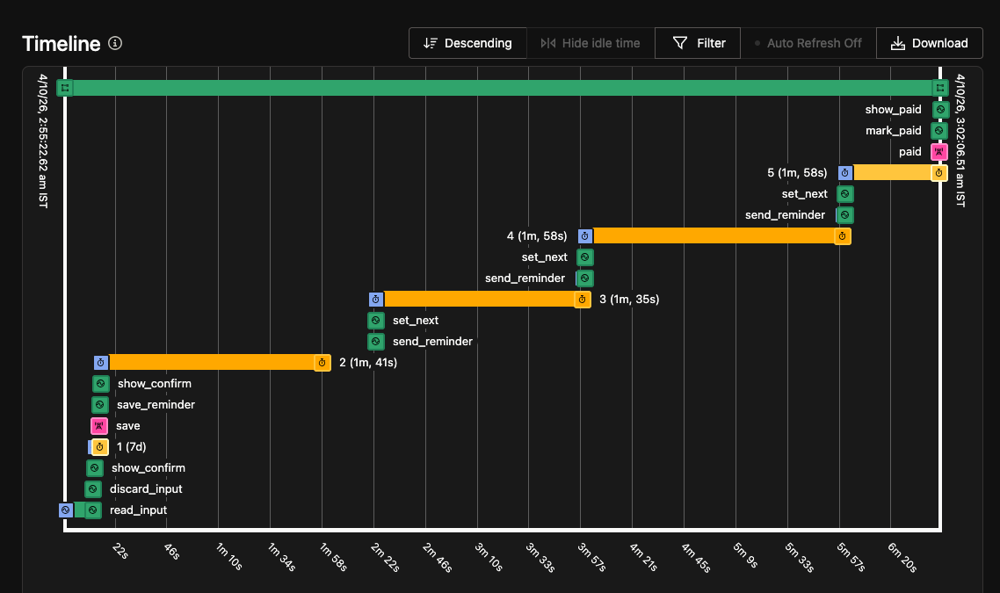

---
hide:
  - feedback
---

# :material-cash-clock: PaidYet

[:material-source-repository: Source Repo](https://github.com/prateek11rai/paidyet){: .report-pill target="_blank" rel="noopener noreferrer" } [:fontawesome-brands-dev: Submission Post](https://dev.to/prateek11rai/paidyet-for-the-friend-who-says-kal-bhej-dunga-p5l){: .report-pill target="_blank" rel="noopener noreferrer" } [:material-trophy: Winners](https://dev.to/devteam/congrats-to-the-hacktoberfest-weekend-challenge-build-for-a-friend-winners-pgc){: .report-pill target="_blank" rel="noopener noreferrer" }

> Keeps reminding your friend until they've actually paid. A Telegram bot on a laptop: local Gemma reads the IOU, one Temporal workflow per reminder nudges until it's paid. Won Best Use of Temporal in the DEV Hacktoberfest 2026 Weekend Challenge.

{ loading=lazy }

## :material-lightbulb-outline: The Problem

Arjun is a composite of friends we all have. He's generous, he's first to say "I'll pay my share", and when you remind him he says "haan bhai, kal bhej dunga" ("yeah, I'll send it tomorrow"). He means it. Then the reminder sinks under forty messages in a group chat, and nobody wants to be the one who asks twice.

It's never about the money. His share of a dinner someone else paid for, the ₹500 a friend lent him, his part of the flat's electricity and broadband: the intention survives, the reminder doesn't.

## :material-monitor-dashboard: What It Does

PaidYet is a Telegram bot that runs on a laptop and does the remembering for him. Send it a bill photo or a line like "Rahul ko 500 dene hai Friday tak". Gemma, running locally in Ollama, reads it, and you tap Save. Then a durable Temporal workflow keeps reminding you until you tap Paid. Sentry traces every step without seeing the bill.

Reading a bill happens on your machine. The reminders survive the laptop sleeping, restarting or crashing. An admin (you, if you run it for friends) can add dues for a friend, and every reminder says who added it. He's on Android, he already lives in Telegram, and he writes in Hinglish. So there's nothing to install and nothing new to learn.

1. **Capture.** Send a bill photo or screenshot, forward a message, or type a line in English or Hinglish.
2. **Gemma reads it.** It fills in title, payee, amount, due date and kind. Plain code then checks the answer: it parses the dates, rejects past due dates and odd amounts, and refuses to save a bill whose date it can't trust.
3. **Confirm.** "Electricity · ₹1,240 · due Fri 9 Oct", then the whole plan ("I'll remind you Tue 6 Oct 10 AM, Thu 8 Oct 7 PM, Fri 9 Oct 10 AM and 7 PM, then every morning until it's paid"), with **✅ Save** and **✏️ Fix**.
4. **Temporal reminds.** On the schedule below, durably, until Paid.
5. **Paid or Snooze.** **✅ Paid** closes it. **😴 Snooze** offers Tomorrow, In 3 days, or a date picker, and it only ever postpones.

| Due | Reminders |
|---|---|
| A date ("Friday tak", a bill due 12 Oct) | 10 AM three days before (if it's at least 3 days away), 7 PM the evening before, 10 AM and 7 PM on the day, then 10 AM daily while overdue |
| A time at least 1 hour away ("in 5 hours") | 30 minutes before and at the deadline, then 10 AM daily |
| A time 10 minutes to 1 hour away | At the deadline, then 10 AM daily |
| Under 10 minutes (demo mode, "in 2 minutes") | At the deadline and every 2 minutes after, 5 times in all, then 10 AM daily |

Nothing goes out between 22:00 and 08:00, except demo reminders. After 30 days overdue, PaidYet sends one last message, and the due then waits quietly in `/due` until it's paid.

{ loading=lazy }

{ loading=lazy }

## :material-sitemap-outline: How It Works

It's Python, built on python-telegram-bot, Temporal, Ollama running `gemma4:e4b`, and Sentry. One command starts Ollama (bound to 127.0.0.1), a Temporal dev server and the bot, and Ctrl-C stops all three.

**Gemma** (`gemma4:e4b` in Ollama) reads photos and Hinglish through Ollama's JSON-schema structured output, at temperature 0 with thinking off. It's asked to *quote* the words around the deadline ("Pay by 12 Oct 2026"), and code parses the date out of that quote.

**Temporal** runs one `ReminderWorkflow` per due, from the moment a message arrives. Reading the bill is a retried activity, so a slow model load or bad JSON just gets another try. The input is deleted after the read, on success or final failure. Then the workflow waits durably for Save or Fix, sends reminders on timers, and reacts to Paid and Snooze signals.

{ loading=lazy }

**Sentry Agent Tracing** shows each read as an `invoke_agent` span. Inside it are a `gen_ai.chat` span per Gemma call and `execute_tool` spans for the code checks. Temporal interceptors keep one trace from the Telegram update through the workflow into every activity, including a reminder sent days later.

## :material-shield-lock-outline: Privacy

- **Photos.** A photo is written to a temporary folder under a random name, readable only by you, and deleted as soon as Gemma has read it.
- **Text.** What you type is held in memory only until it's read. Temporal's history gets a random key, never the text, the image or Gemma's raw reply.
- **Sentry** gets model names, token counts and timings. It never gets prompts, replies, amounts, names or images. A unit test sends a read through Sentry's real configuration and checks nothing leaks.
- **Ollama** listens only on 127.0.0.1.

## :material-trophy-outline: Built For

The DEV Hacktoberfest Weekend Challenge: Build for a Friend, part of Hacktoberfest 2026 (MLH × DEV). The submission post: [PaidYet: for the friend who says “kal bhej dunga”](https://dev.to/prateek11rai/paidyet-for-the-friend-who-says-kal-bhej-dunga-p5l). Prize categories entered: **Best Use of Gemma**, **Best Use of Temporal** and **Best Use of Sentry Agent Tracing**. PaidYet won **Best Use of Temporal**.

{ loading=lazy width=160 }

## :material-source-repository: The Repo

Full source, the build log and the submission post are on GitHub:

[:octicons-mark-github-16: prateek11rai/paidyet](https://github.com/prateek11rai/paidyet)

---

:material-trophy: Winner, Best Use of Temporal, in the **DEV Hacktoberfest 2026 Weekend Challenge**. Built in October 2026.
