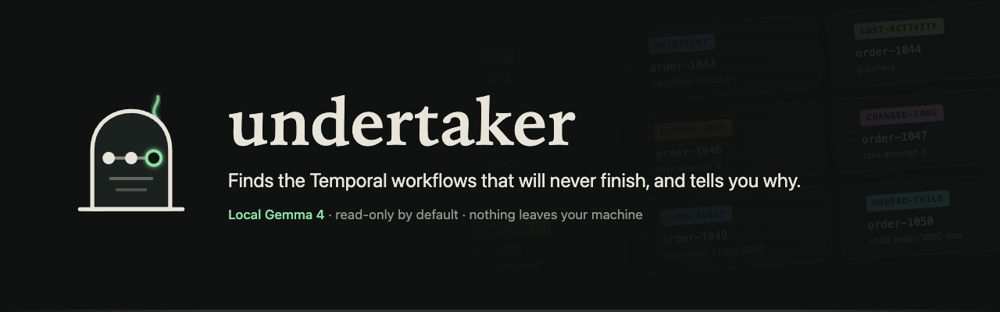
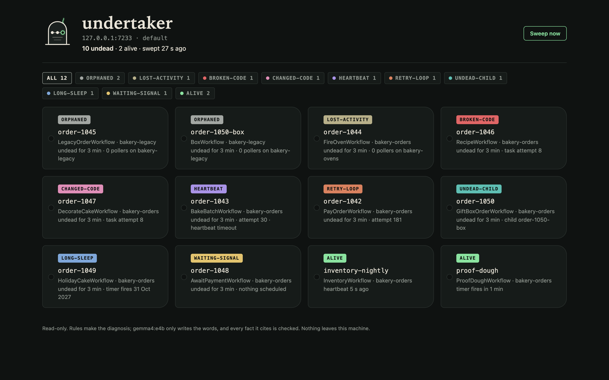
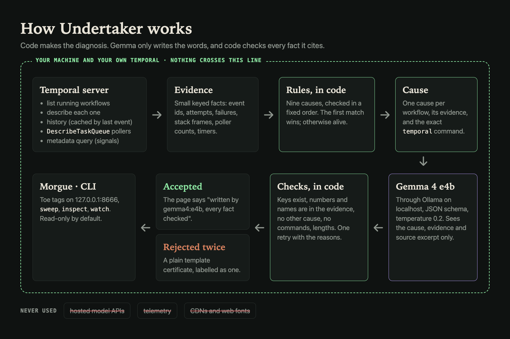
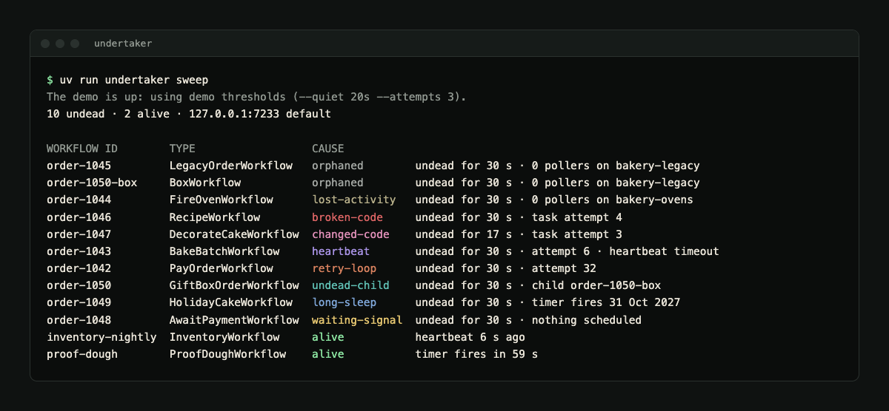
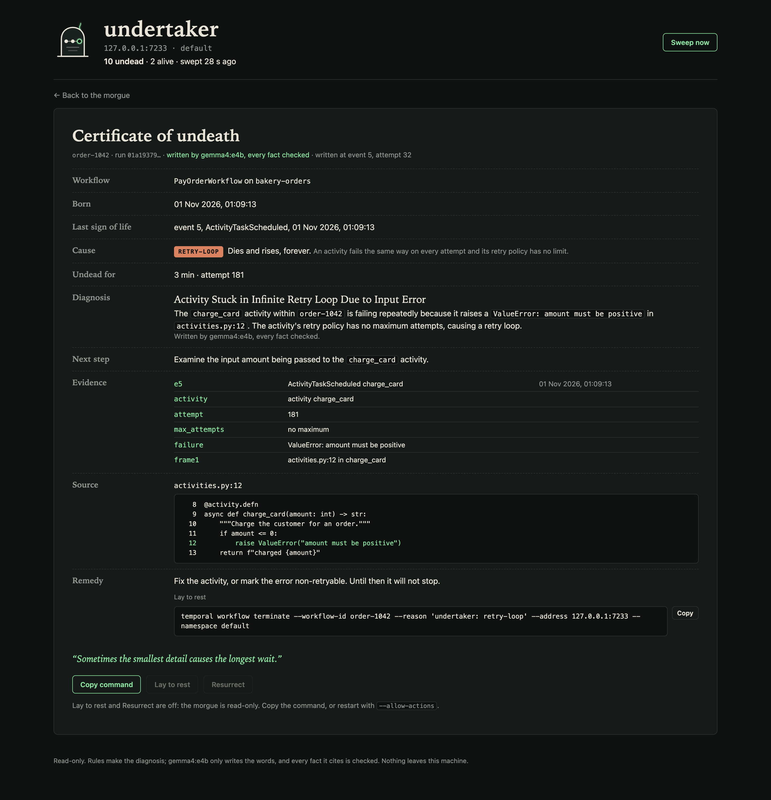

---
hide:
  - feedback
---

# :material-skull-outline: Undertaker

[:material-source-repository: Source Repo](https://github.com/prateek11rai/undertaker){: .report-pill target="_blank" rel="noopener noreferrer" } [:fontawesome-brands-dev: Submission Post](https://dev.to/prateek11rai/10-of-my-temporal-workflows-were-never-going-to-finish-a-4b-model-on-my-laptop-wrote-their-death-45f6){: .report-pill target="_blank" rel="noopener noreferrer" }

> Finds the Temporal workflows that will never finish, sorts each one into a cause using Temporal's own data, and writes a checked certificate of undeath for it. Gemma 4 runs on your laptop through Ollama and writes the words; plain code makes the diagnosis and checks every fact the model cites.

{ loading=lazy }

## :material-lightbulb-outline: The Problem

Workflow histories hold real payloads (orders, customers, card errors), and stack traces point into private code. Sending them to a hosted model to ask "why is this stuck" is the thing most teams can't do. A 4B open model on your own machine can.

## :material-monitor-dashboard: What It Does

Undertaker finds the Temporal workflows that will never finish, sorts each one into a cause using Temporal's own data, and writes a checked **certificate of undeath** for it. Gemma 4 runs on your laptop through Ollama and writes the words; plain code makes the diagnosis and checks every fact the model cites. It talks to your Temporal server and to Ollama on localhost, and nothing else: no telemetry, no CDN, no web fonts.

{ loading=lazy }

## :material-sitemap-outline: How It Works

{ loading=lazy }

1. **Code diagnoses.** A sweep lists running workflows, then reads `describe`, the history and the task-queue pollers. Fixed rules, in a fixed order, pick the cause and collect evidence: event ids, attempts, failures, stack frames, poller counts.
2. **The model explains.** Gemma 4 e4b gets the cause, the rule, the evidence and (with `--source`) the function around each frame, read only from files inside your source folder. It answers in an Ollama JSON schema: headline, diagnosis, cited evidence keys, next step and an epitaph.
3. **Code checks the model.** One retry with the reasons, then a plain template. The page always says which one you are reading.
4. **Commands come from code.** The model never writes commands.

## :material-coffin: Causes of Undeath

| Cause | Shown as | Rule |
|---|---|---|
| `orphaned` | No one is listening | Workflow task scheduled, never started, for longer than `--quiet`, and no poller on its task queue |
| `lost-activity` | Sent to a worker that never came | Activity scheduled for longer than `--quiet`, no poller on that activity's task queue |
| `broken-code` | Its own code keeps killing it | Workflow task attempt ≥ 2 and the last `WorkflowTaskFailed` is a plain error |
| `changed-code` | Its code changed while it slept | The same, but the failure is non-determinism |
| `heartbeat` | Stopped breathing | Activity attempt ≥ `--attempts`, last failure a heartbeat timeout |
| `retry-loop` | Dies and rises, forever | Activity attempt ≥ `--attempts`, a real failure, no retry maximum in sight |
| `undead-child` | Waiting on an undead child | A pending child workflow that is itself undead |
| `long-sleep` | Asleep for a very long time | An open timer longer than `--long-sleep` |
| `waiting-signal` | Waiting for a visitor who never comes | Nothing pending at all and the last event older than `--quiet` |
| `alive` | Alive | None of the above, with the reason ("heartbeat 3 s ago", "timer fires in 40 s") |

The first matching rule wins, in this order. Every remedy comes with the exact `temporal` command, with your `--address` and `--namespace` filled in.

{ loading=lazy }

## :material-certificate-outline: Certificates and Checks

{ loading=lazy }

The checks, all in code:

- every cited evidence key exists;
- every number in the text appears in the evidence;
- every code span, file name, `file:line`, activity or signal name appears in the evidence or the source excerpt;
- no other cause is named;
- no commands or URLs;
- the lengths hold (headline 12 words, diagnosis 70, next step 30, epitaph 14);
- the epitaph has no digits and no identifiers.

Failure messages reach the model inside `<data>` tags as data, and all model text is HTML-escaped before it reaches the page.

## :material-chart-box-outline: Measured on the Demo

Two runs on a fresh demo, on an Apple Silicon Mac with `gemma4:e4b`:

| | Run 1 | Run 2 |
|---|---|---|
| Undead found by the rules | 10/10 | 10/10 |
| Missed | 0 | 0 |
| False alarms | 0 | 0 |
| Alive and right | 2/2 | 2/2 |
| Gemma certificates accepted on the first try | 10/10 | 10/10 |
| Fell back to the template | 0 | 0 |
| Seconds per certificate | 8.4 | 7.6 |

These are ten made-up workflows, built on purpose to match the rules, so treat them as a smoke test rather than a benchmark.

## :material-alert-circle-outline: Limits

- Tested against the Temporal dev server and Python workers only. Other SDKs' stack traces are shown as text without source lookup.
- No Temporal Cloud, mTLS or API-key login yet.
- Rules are heuristics with thresholds; a slow but healthy workflow can look undead until the thresholds are tuned.
- `waiting-signal` can't know whether the signal is still coming; it says so.
- Undertaker is read-only unless you pass `--allow-actions`.

## :material-trophy-outline: Built For

The DEV Hacktoberfest Open-Source AI Challenge, Week 4: Ghost in the Machine, part of Hacktoberfest 2026 (MLH × DEV). The submission post: [10 of my Temporal workflows were never going to finish. A 4B model on my laptop wrote their death certificates](https://dev.to/prateek11rai/10-of-my-temporal-workflows-were-never-going-to-finish-a-4b-model-on-my-laptop-wrote-their-death-45f6).

## :material-source-repository: The Repo

Full source, the build log and the design spec are on GitHub:

[:octicons-mark-github-16: prateek11rai/undertaker](https://github.com/prateek11rai/undertaker)

---

:material-skull-outline: Built for the **DEV Hacktoberfest 2026 Week 4 challenge: Ghost in the Machine**, October–November 2026.
